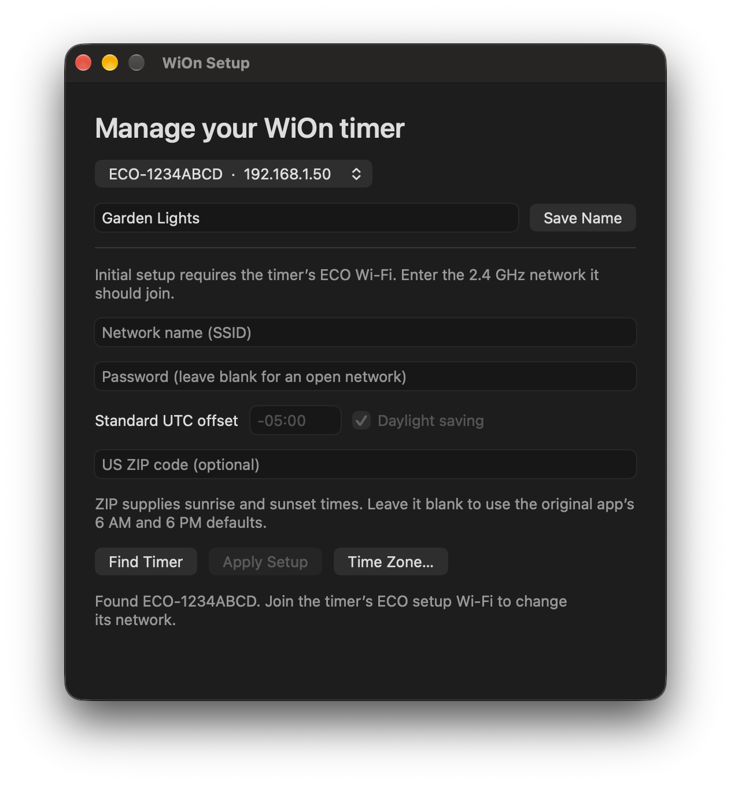

# ECO Plugs and WiOn Setup

Set up legacy **ECO Plugs** and **WiOn** Wi-Fi timers and outlets with the WiOn Setup macOS app or the Python CLI for Windows and Linux. Both tools are independent of the manufacturer. It connects directly to the timer’s temporary setup network and sends the credentials for your 2.4 GHz home network. Once the timer joins, the app can read and change its display name over your home network. Setup runs locally and requires no cloud account.

Use WiOn Setup for the initial Wi-Fi connection. After the device has joined, [homebridge-ecoplugs](https://github.com/homebridge-plugins/homebridge-ecoplugs#tested-devices) can discover and control supported devices on the same subnet.

Some devices in the ECO Plugs family were sold as **Woods WiOn**, **WorkChoice**, or **DEWENWILS**. An `ECO-` device ID is a clue. Initial Wi-Fi setup targets legacy FtNetManager firmware and has been verified on a WiOn stake timer. See [Compatibility](#compatibility) for firmware details. [WorkChoice and Woods hardware comparison](https://blog.adafruit.com/?p=189576) · [DEWENWILS TM-050B manual](https://images.thdstatic.com/catalog/pdfImages/c3/c3a5ec2f-5e4f-4311-845e-2d0c39dd8a5d.pdf)

## Why this exists

The original ECO Plugs iOS app could no longer onboard my WiOn timer after a factory reset. I built WiOn Setup to get the timer back onto my home Wi-Fi using a Mac, and added a Python CLI so people can do the same on Windows and Linux.



## Setup

1. Put the timer in setup mode using the instructions for your model.
2. Connect your Mac to the timer’s temporary ECO Wi-Fi network.
3. Open **WiOn Setup** and allow local network access if macOS asks. Click **Find Timer** if needed.
4. Enter the timer’s display name and its 2.4 GHz Wi-Fi credentials. Review the Mac-derived standard UTC offset and daylight-saving choice. Enter the timer’s US ZIP code to calculate local sunrise and sunset times.
5. Click **Apply Setup**. The app sends the night-light setting, the sunrise/sunset table, and the settings record. It clears the password field. Stay on the ECO network while the app waits for setup to complete. When it starts looking for the timer on your home Wi-Fi, reconnect the Mac if needed. If the check times out, click **Find Timer** after reconnecting.

Setup loads the times the timer needs for astronomical schedules. Creating an on/off schedule is a separate operation. With a blank ZIP, setup uses the original app’s fixed 6 AM and 6 PM defaults. The ZIP lookup runs offline using the bundled US Census coordinates.

To rename an existing timer, select it from the list on your home Wi-Fi, enter a display name, and click **Save Name**. The app reads the name back to confirm the change.

## Compatibility

WiOn Setup targets legacy ECO Plugs and WiOn devices that use the FtNetManager protocol. Wi-Fi provisioning and name reads were verified on a WiOn stake timer running firmware 1.7.1.

**KAB** is the name the Homebridge ECO Plugs plugin uses for a different local network protocol found in some ECO Plugs firmware. The same model can ship with either protocol. For example, the plugin lists the ECO Plugs CT-065W outlet with both legacy and KAB firmware. Initial Wi-Fi setup for KAB firmware is unverified with WiOn Setup. [Homebridge tested devices](https://github.com/homebridge-plugins/homebridge-ecoplugs#tested-devices)

## Build from source

Install Xcode Command Line Tools, then run:

```sh
./build.sh
```

Unzip `build/WiOn Setup.zip` to open the app. The build targets macOS 13 and later on Apple silicon and Intel. The local build uses ad-hoc signing.

## Python CLI for Windows and Linux

Requires Python 3.9 or later. On Windows, replace python3 with py -3. Keep `zip-coordinates.csv` beside the script. If prompted, allow Python to communicate on the private network.

Connect to the timer’s temporary ECO Wi-Fi, then run:

    python3 wion_setup.py wifi "My 2.4 GHz Network" --name "Garden Lights" --offset=-05:00 --dst=on --zip 12345

Replace the example time zone and ZIP with yours. The name, time zone and ZIP options are optional. Enter the password at the hidden prompt. For an open network, add --open-network. The default setup gateway is 192.168.4.1. Use --host 192.168.5.1 if your timer uses that address. Use --device-id ECO-XXXXXXXX to require a specific timer before writing.

Stay on the ECO network until the `wifi` command finishes its setup-status checks. Then reconnect your computer to your home Wi-Fi and confirm that `info` shows your network under `Settings-record SSID`:

    python3 wion_setup.py discover
    python3 wion_setup.py info 192.168.1.50
    python3 wion_setup.py name 192.168.1.50 "Garden Lights"

Replace the example IP with the address from discovery. If discovery goes out the wrong adapter, specify both your computer’s local address and subnet broadcast address:

    python3 wion_setup.py discover --local-ip 192.168.1.20 --broadcast 192.168.1.255

Discovery replies require inbound UDP port 8900. Broadcasts stay on the local subnet. If broadcasts are blocked and you know the timer’s IP, info and name use unicast discovery. Use --local-ip with those commands or wifi to select a local address.

## Theory of operation

### Two network connections

In setup mode, the timer creates a temporary Wi-Fi access point and gives the computer an address on its setup subnet. The client sends the Wi-Fi credentials directly to that setup gateway. The timer uses them to join the router and obtain a home-network IP address. The ECO device ID identifies the same timer across both connections. Rename uses a separate command and works on the home network.

### Discovery

The client sends a 128-byte UDP discovery packet to ports 25 and 5888 and listens on port 8900. It uses the setup gateway for onboarding and local broadcast for LAN discovery. The packet includes the year as a little-endian 16-bit integer at offset 24, month and day at offsets 26 and 27, and seconds since midnight as a little-endian 32-bit integer at offset 28.

The legacy response is 408 bytes. A settings record starts at offset 4, the device ID is at offsets 10–41, and the command port is a little-endian 32-bit integer at offset 404. The client uses the response’s source IP and advertised port for commands. Firmware 1.7.1 on the tested timer advertised UDP port 80. HTTP uses TCP.

### Command framing

Commands have a 128-byte header followed by an optional payload. Offsets are zero-based.

| Offset | Bytes | Meaning |
| --- | ---: | --- |
| 0 | 4 | Command code, little-endian |
| 4 | 2 | Result code in replies, little-endian |
| 6 | 2 | Sequence number, little-endian |
| 8 | 2 | Payload length, little-endian |
| 10 | 102 | Device identity fields copied from discovery |
| 116 | 4 | Low 32 bits of the client timestamp in milliseconds |
| 124 | 4 | Client ID, reused within a session |

The client checks the sender, command code, and sequence number. A result of 0 indicates success, 3 indicates a refusal, and 6 can indicate a pending setup status. UDP send completion only means that the OS accepted the datagram for transmission.

### Wi-Fi provisioning

1. Read settings with command 0x50005 and verify that the 364-byte record identifies the selected timer.
2. Request a scan with 0x50012. The legacy scan reply carries a 976-byte payload. The client uses the same UDP socket and client ID for the settings read, scan, and write.
3. Send 0x5001B with bytes `01 00`, the original app’s startup value for night-light channel 1. The second byte is the off state.
4. Send the 1,098-byte sunrise/sunset table using 0x50018.
5. Send the settings record using 0x50004. Replace bytes 116–179 with the SSID and bytes 180–243 with the Wi-Fi password, padding each field with NUL bytes. A combined setup also writes the display name at 38–69, clock at 104–115, and optional US country code and ZIP at 246–265. It preserves the remaining settings.
6. Send paired UDP datagrams. The client retries the initial settings write once on timeout, reusing its sequence number and client ID. It then polls setup status (0x50105) at three-second intervals over the same setup connection, up to four times. Android handles status 0 by sending the night-light, astronomical table, and settings writes again. The clients now repeat that sequence on status 0 as well. A status 6 observed outside that setup window also occurs on working timers.
7. Rediscover on the home network and match the ECO ID. The timer can switch networks before its write reply reaches the client. A timeout alone cannot distinguish a delayed join from a failed one.

The protocol carries credentials without application-layer encryption. The clients send them to the timer’s setup gateway and do not log or store them. Discovery and the settings command can report different SSID strings for the same device. The CLI shows both. Use a fresh reply from the matching device ID on your home network to verify connectivity. Compare the settings-record SSID with the intended SSID separately. See [Why a timer can join Wi-Fi and still blink blue](#why-a-timer-can-join-wi-fi-and-still-blink-blue) for the firmware 1.7.1 behavior that prompted the second setup pass.

### Sunrise and sunset table

The timer receives one row for each of the 366 calendar slots from January 1 through December 31, including February 29. Each three-byte little-endian row packs the sunrise minute in the upper 12 bits and the sunset minute in the lower 12 bits. The table uses local standard time. Daylight saving is stored separately in the clock settings. The clients report explicit rejections separately from the Wi-Fi result.

`zip-coordinates.csv` contains ZIP Code Tabulation Area representative coordinates from the [2024 U.S. Census Gazetteer](https://www.census.gov/geographies/reference-files/time-series/geo/gazetteer-files.2024.html). Some postal ZIP codes have no corresponding Census area. The clients calculate approximate times with [NOAA’s solar equations](https://gml.noaa.gov/grad/solcalc/solareqns.PDF). ZIPs with days without sunrise or sunset are unsupported because the timer’s table requires two times per day.

### Rename

Read settings and send command 0x50013 with a 102-byte payload. Bytes 38–69 hold the UTF-8 display name, padded with NULs. Bytes 70–101 hold the current device password field copied from settings. The CLI and macOS app read back the display name to verify the change.

### Why a timer can join Wi-Fi and still blink blue

A timer can join your home Wi-Fi and respond to local commands while its blue light keeps blinking and its temporary ECO hotspot stays visible. On the WiOn stake timer running firmware 1.7.1, a settings read in this state still reported `ECO-Plugs` as the saved Wi-Fi name.

The Android ECO Plugs app polls the timer’s setup status. When the timer replies with status `0`, the app sends the night-light setting, the sunrise and sunset table, and the full settings record again. WiOn Setup follows the same sequence. The timer’s light went solid blue in a live macOS test. The Python CLI follows the same sequence and was verified with simulated timer replies. The firmware’s internal reason for keeping the hotspot active is unknown.

To check setup on your timer, look for a solid blue light and confirm that the temporary ECO hotspot has disappeared. On the CLI, run `info` and compare `Settings-record SSID` with your home network name. A status `6` outside the setup window is inconclusive. The tested timer also returned it after successful setup.

### Time zone and daylight saving

On macOS, select the timer, click **Time Zone…**, enter a standard UTC offset, and choose whether to enable daylight saving. On the CLI, inspect the current value with info and set it with timezone:

    python3 wion_setup.py timezone 192.168.1.50 --offset=-05:00 --dst=on

Use the standard offset, even during daylight saving. For example, US Eastern uses -05:00. Omitting --dst preserves the current flag. The CLI also accepts --offset and --dst on the wifi command to include the time zone during onboarding.

The settings record contains a 12-byte clock structure at offset 104. The same structure is the payload for command 0x50015. The first two bytes contain a little-endian year with bit 0x1000 used for the daylight-saving flag. The next bytes hold the month and day, followed by seconds since midnight as a little-endian 32-bit integer. The last four bytes hold a signed offset in seconds relative to UTC+08:00, so UTC−05:00 encodes as −46,800 seconds. The clients initialize the date and time from the computer using the requested standard offset and verify the reported offset and flag after writing. The standalone command’s ability to persist a changed offset is unverified on physical hardware.
